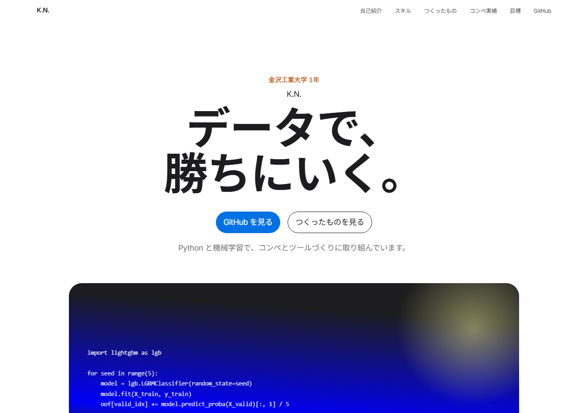
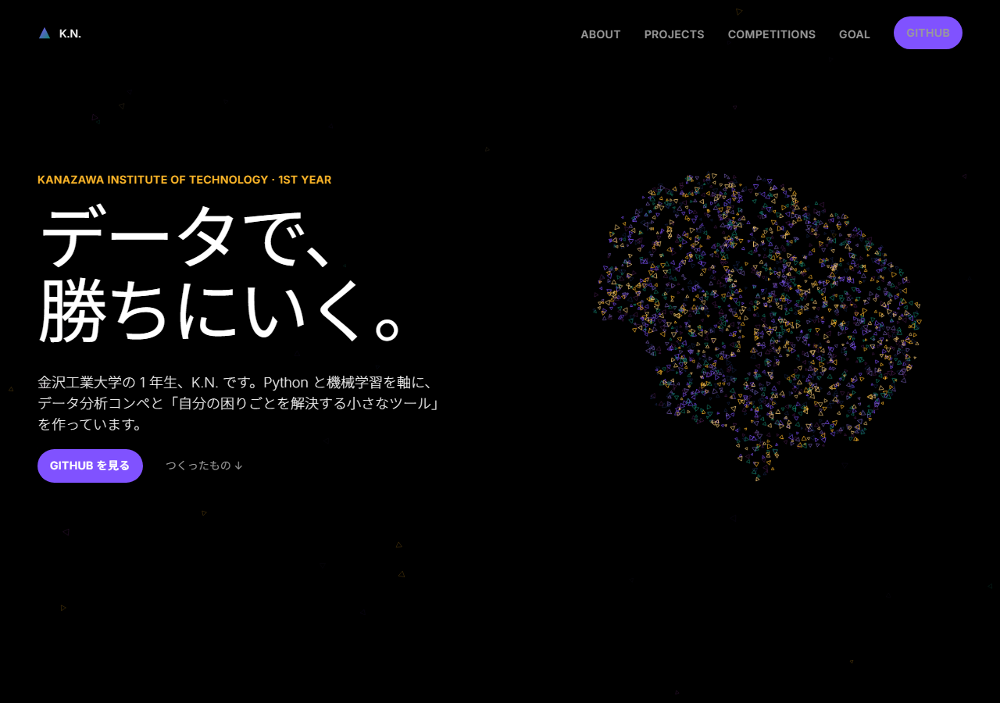

# intro-site — 自己紹介サイト

金沢工業大学 1 年・K.N. の自己紹介サイトです。
同じ内容を **2 つのデザインシステム** で実装し、見比べられるようにしています。

| ライトテーマ (`index.html`) | ダークテーマ (`index-dark.html`) |
|---|---|
|  |  |

公開ページ: https://kotakota914.github.io/intro-site/ (ダーク版は `/index-dark.html`)

## なにを作ったか

- **ライト版**: Apple の製品ページを参考にしたスタイルガイドをもとに実装。白と `#f5f5f7` の帯を交互に並べ、角丸 28px のカード、ピル型ボタン、影なし・罫線なしで構成
- **ダーク版**: 黒背景に紫 1 色のアクセントというスタイルガイドをもとに実装。見出しは太字にせず大きさと字間で階層を作り、本文は weight 200 の細字。ヒーローには **三角形のパーティクル約 2,200 個で描いた脳の形** を Canvas でアニメーションさせている

どちらもフレームワークやビルドツールを使わない **単一の HTML ファイル** です。ブラウザで開くだけで動きます。

## 使い方

```bash
git clone https://github.com/kotakota914/intro-site.git
cd intro-site
# そのままブラウザで開く
start index.html        # Windows
open index.html         # macOS
```

内容を書き換えるときは、各 HTML の `<body>` 内のテキストを直接編集してください。
色・余白・角丸などは `<style>` 先頭の `:root { --color-... }` にまとめてあります。

## 構成

```
intro-site/
├── index.html        # ライト版
├── index-dark.html   # ダーク版(Canvas アニメーション付き)
├── docs/             # README 用スクリーンショット
└── README.md
```

## 使用技術

- HTML / CSS(CSS カスタムプロパティ、Grid、`clamp()` によるレスポンシブ文字サイズ)
- JavaScript(ダーク版のみ。Canvas 2D、`requestAnimationFrame`、`IntersectionObserver`)
- Google Fonts(Inter、Noto Sans JP)

## 実装メモ(ダーク版のパーティクル)

- 脳の形は楕円 5 つの和集合として関数で定義し、ランダムな点のうち領域内に入ったものだけを採用
- 三角形は色ごとにまとめて 1 回の `stroke()` で描き、30fps に間引き、画面外では描画を止めて負荷を抑えている

## ライセンス

MIT
